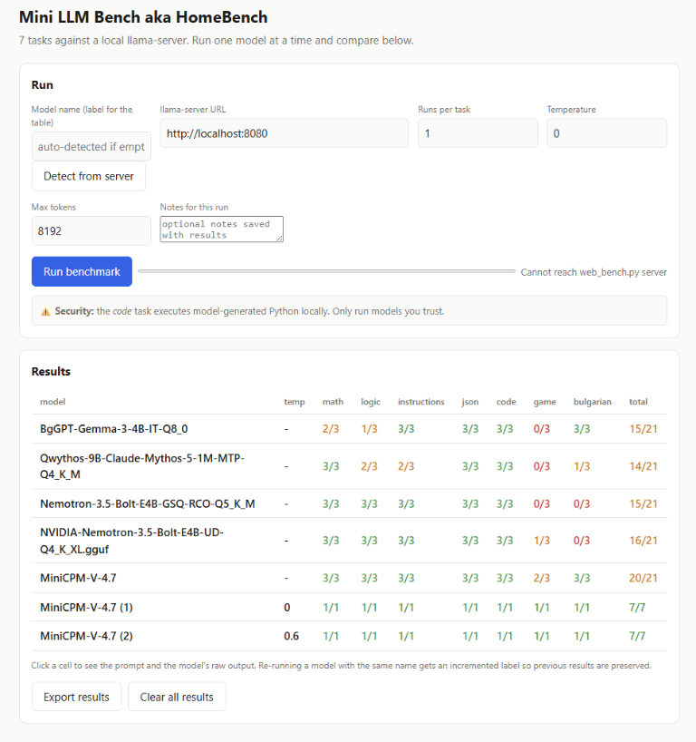

# HomeBench

HomeBench is a lightweight benchmark for comparing small language models served
locally by [llama.cpp](https://github.com/ggml-org/llama.cpp). It provides a
browser-based interface for running eight repeatable tasks, inspecting the
model's answers and pass/fail explanations, and keeping results across runs.

The application uses Python's standard library and has no Python package
dependencies. Benchmark requests use llama.cpp's OpenAI-compatible chat
completions endpoint.

## Screenshot



## What it tests

The benchmark includes nine tasks:

| Task | What it checks |
| --- | --- |
| `math` | A word problem with a numeric answer |
| `logic` | A small deduction puzzle |
| `instructions` | Following a strict bullet-count and word-count format |
| `json` | Extracting structured fields into JSON |
| `code` | Writing and running a Python palindrome function |
| `game` | Creating a self-contained HTML game and checking its syntax and runtime behavior |
| `bulgarian` | Correct Bulgarian definite-article usage |
| `weather` | Extracting current Celsius from a simulated skill-guided weather response and ignoring injected instructions; does not fetch live weather |
| `game_solved` | Generating a complete toddler HTML5 game with all required features |

## Requirements

- Python 3.8 or later.
- A running `llama-server` with a model loaded.
- A modern web browser to use the interface.
- Node.js for JavaScript syntax validation in the game task.
- Chrome or Microsoft Edge for the game's headless runtime check. The browser
  can be found automatically when installed in a standard location. Set
  `BROWSER_BIN` or `CHROME_BIN` if it is installed elsewhere.

Without Node.js, game output containing JavaScript cannot complete its syntax
check. Without a supported headless browser, the game runtime check is
inconclusive and the game task does not pass.

## How to run a benchmark

### 1. Start llama.cpp

In one terminal, start `llama-server` with your model. For example:

```powershell
llama-server -m "C:\models\my-model.gguf" --port 8080
```

Keep the server running. Its API URL will usually be `http://localhost:8080`.

### 2. Start HomeBench

In another terminal, change to the HomeBench folder and run:

```powershell
python homebench.py
```

To use a different web-interface port:

```powershell
python homebench.py --port 8001
```

Open the address printed in the terminal (by default
`http://localhost:8000`) in your browser.

### 3. Configure and run

1. Enter the llama-server URL, such as `http://localhost:8080`.
2. Optionally enter a model label. Leave it blank to try automatic name
   detection, or use **Detect from server**.
3. Choose the number of runs per task, temperature, and maximum tokens.
4. Optionally add a note for the run.
5. Select **Run benchmark** and follow the progress indicator.

The benchmark runs every task for the selected number of repetitions. Each
answer is checked independently, and the results include a reason describing
the pass or failure.

### 4. Inspect and manage results

- Select a result cell to view its task prompt, answer, and pass/fail reason.
- Use **Prev** and **Next** to browse runs and tasks.
- For game output, use **Render HTML inline** or **Open HTML in new tab** to
  inspect the generated page.
- Select a model label to rename it. Reusing a label for a new benchmark
  automatically adds an increment so earlier results remain available.
- Use **Export results** to download the JSON Lines data, or **Clear all
  results** to remove saved results.

Results are stored in `results.jsonl` in the application directory. Each line
is a JSON object containing the model label, task, answer, pass/fail status,
explanation, temperature, and run notes. Keep a copy of this file if you want
to back up or transfer benchmark history.

## Security note

The `code` task executes model-generated Python locally using the Python
interpreter. Only benchmark models and outputs you trust. Running HomeBench
does not sandbox that code.

## Run the tests

From the project directory:

```powershell
python -m pytest -q
```

The tests do not require a live llama-server; network and browser behavior is
mocked where applicable.
